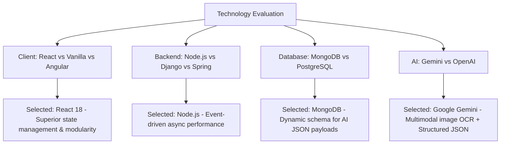
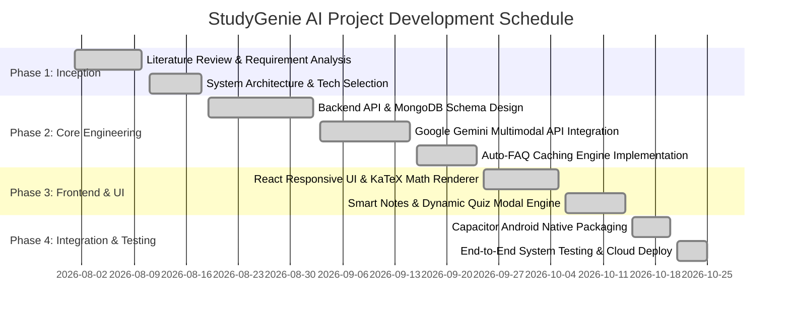
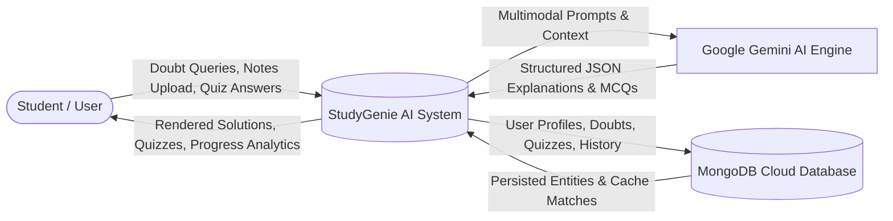
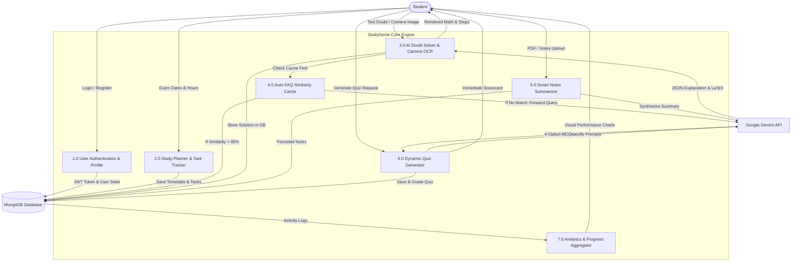
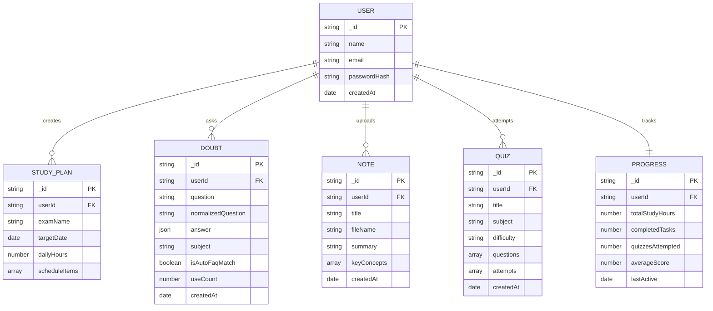
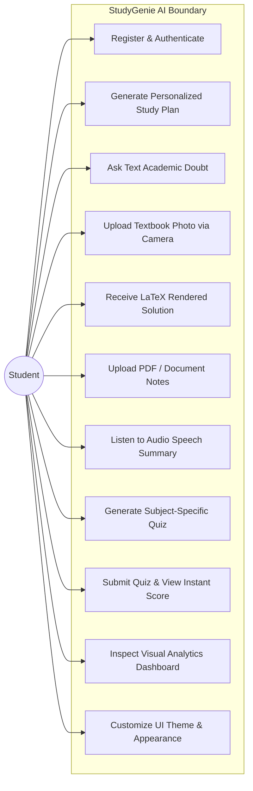
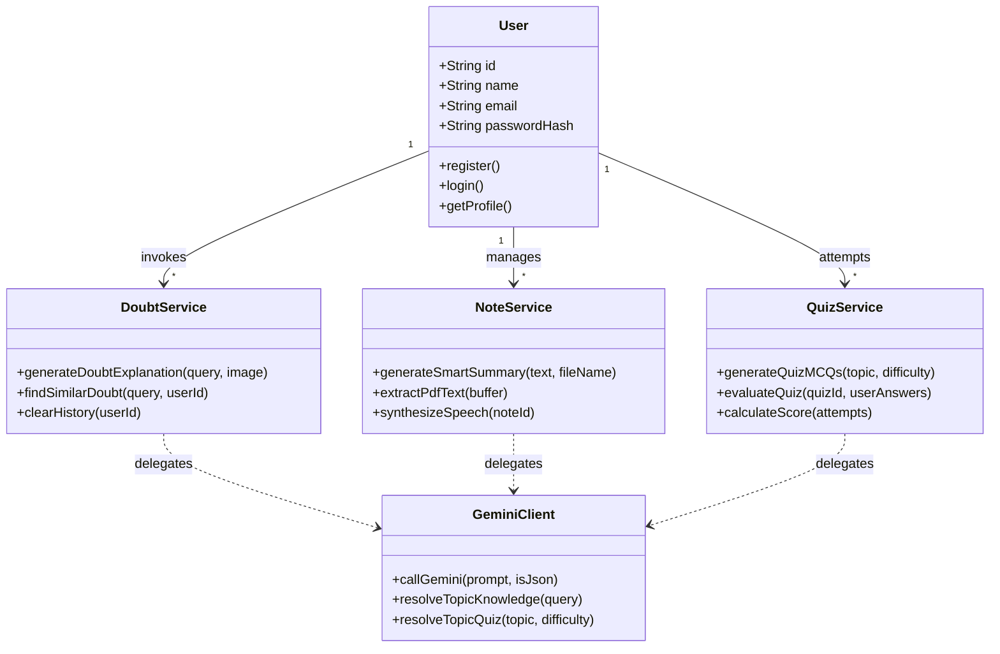
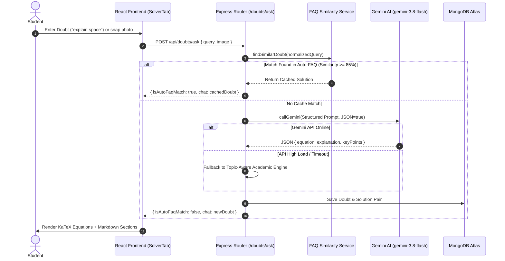
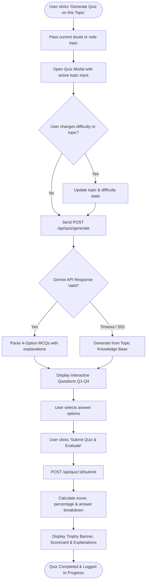

# STUDYGENIE AI — COMPREHENSIVE PROJECT DOCUMENTATION REPORT
**An Intelligent, Multi-Platform Academic Study Assistant & Automated Learning Orchestrator**

---

## TABLE OF CONTENTS

| Chapter / Section No. | Topic | Page / Section Ref |
| :--- | :--- | :--- |
| **Chapter 1** | **Introduction** | **Section 1.0** |
| 1.1 | Background | Section 1.1 |
| 1.2 | Objectives | Section 1.2 |
| 1.3 | Purpose and Scope | Section 1.3 |
| 1.4 | Achievement | Section 1.4 |
| 1.5 | Organizational Report | Section 1.5 |
| **Chapter 2** | **Survey of Technology** | **Section 2.0** |
| 2.1 | Available Technologies for the Project | Section 2.1 |
| 2.2 | Selected Technologies and Justification | Section 2.2 |
| 2.3 | Comparative Technology Trade-Off Analysis | Section 2.3 |
| **Chapter 3** | **Requirements and Analysis** | **Section 3.0** |
| 3.1 | Problem Definition & Sub-problems | Section 3.1 |
| 3.2 | Requirement Specification (Functional & Non-Functional) | Section 3.2 |
| 3.3 | Planning and Scheduling (Gantt Chart & PERT Network) | Section 3.3 |
| 3.4 | Software and Hardware Requirements | Section 3.4 |
| 3.5 | Preliminary Product Description | Section 3.5 |
| **Chapter 4** | **Conceptual Models** | **Section 4.0** |
| 4.1 | DFD / Context Level Diagrams (Level 0, Level 1, Level 2) | Section 4.1 |
| 4.2 | Entity-Relationship (ER) Diagram | Section 4.2 |
| 4.3 | UML Diagrams (Use Case, Class, Sequence, Activity) | Section 4.3 |
| **Chapter 5** | **System Design** | **Section 5.0** |
| 5.1 | Data Design (Schema Specifications) | Section 5.1 |
| 5.2 | Procedural Design (Algorithmic Logic & Pipelines) | Section 5.2 |
| 5.3 | User Interface (UI) Design & Interaction Models | Section 5.3 |
| **Chapter 6** | **Security Issues** | **Section 6.0** |
| 6.1 | Real-Time Considerations & Latency Optimization | Section 6.1 |
| 6.2 | Security Problems, Proposed Solutions & Protocols | Section 6.2 |
| **Chapter 7** | **Testing** | **Section 7.0** |
| 7.1 | Testing Approaches | Section 7.1 |
| 7.2 | Test Case Design | Section 7.2 |
| 7.3 | Test Plans and Execution Results | Section 7.3 |
| **Chapter 8** | **Conclusion and Future Scope** | **Section 8.0** |
| 8.1 | Summary of Achievements & Limitations | Section 8.1 |
| 8.2 | Suggestions for Future Improvement | Section 8.2 |

---

# Chapter 1: Introduction

### 1.1 Background
The digital transformation of education has introduced an abundance of learning materials, online lectures, and digital textbooks. However, modern students face acute cognitive overload, fragmented study workflows, and a lack of individualized academic tutoring. Traditional learning approaches suffer from several core deficiencies:
1. **Unstructured Time Allocation**: Students struggle to create balanced daily study schedules that factor in varying subject difficulty and target examination dates.
2. **Delayed Feedback on Academic Doubts**: When students encounter complex mathematical derivations, algorithmic logic, or scientific concepts late at night, they lack immediate tutoring assistance.
3. **Passive Reading vs. Active Recall**: Traditional document consumption lacks automated active recall mechanisms (e.g., flashcard generation, subject-tailored multiple-choice testing, and instant performance benchmarking).
4. **Platform Disconnect**: Desktop web applications frequently fail to integrate with mobile hardware (such as camera OCR for photographing textbook equations or offline local synchronization).

**StudyGenie AI** was conceptualized and developed to bridge this gap. By orchestrating cutting-edge Large Language Models (Google Gemini 3.8/3.5 series), modern reactive user interfaces, and mobile runtimes, StudyGenie AI delivers an end-to-end autonomous academic learning environment.

### 1.2 Objectives
The primary objectives of the StudyGenie AI project are:
- **Intelligent Schedule Orchestration (FR1 & FR2)**: To generate personalized, mathematically distributed study timetables based on user-selected exam dates, available daily hours, and subject priorities.
- **Multimodal AI Doubt Resolution (FR3)**: To construct a 24/7 academic tutor capable of resolving textual queries and photographed textbook problems with rendered LaTeX equations, step-by-step conceptual proofs, and takeaway summaries.
- **Auto-FAQ Real-Time Cache Engine (FR4)**: To eliminate redundant API overhead by caching solved queries and retrieving high-similarity solutions instantly using textual similarity metrics.
- **Smart Document Summarizer (FR5)**: To extract, parse, and synthesize uploaded PDF and text lecture notes into structured chapter outlines, core definitions, and audio-synthesized review notes.
- **Dynamic Subject-Specific Quiz Engine (FR6)**: To automatically generate 4-option multiple choice questions (MCQs) tailored to any academic topic, complete with real-time scoring and explanatory answer breakdowns.
- **Visual Analytics & Progress Tracking (FR7)**: To record completed study sessions, quiz accuracy, and daily task velocity with interactive charts.
- **Cross-Platform Parity & Accessibility (FR8)**: To deploy simultaneously as a responsive Web Application (Vercel) and an Android Mobile Application (Capacitor/Gradle) with persistent dark/light theme customization.

### 1.3 Purpose and Scope
#### Purpose
The purpose of StudyGenie AI is to serve as an intelligent, single-pane study operating system for students across secondary, collegiate, and professional engineering education. It eliminates the friction of switching between separate calendar apps, doubt-clearing forums, flashcard software, and document readers.

#### Scope
- **Domain Scope**: STEM disciplines (Physics, Chemistry, Mathematics, Computer Science, Engineering) as well as humanities, law, and business.
- **Functional Scope**:
  - Interactive web application supporting all modern web browsers (Chrome, Edge, Firefox, Safari).
  - Cross-platform Android APK executable on Android 10+ (API Level 29+).
  - RESTful backend API handling secure authentication, database persistence, and AI inferencing.
- **Out of Scope for Current Release**: Multi-user real-time collaborative whiteboard sessions and live video conferencing (scheduled for future releases).

### 1.4 Achievement
StudyGenie AI has accomplished full end-to-end deployment across both web and native mobile environments:
- **Production Web Deployment**: Live and publicly accessible on [study-genie-seven.vercel.app](https://study-genie-seven.vercel.app).
- **Backend Cloud Deployment**: Managed production service with MongoDB Atlas database cluster on Render and localhost port 5000.
- **Android Native Mobile Package**: Compiled and synced via Capacitor 6 for mobile deployment (`com.studygenie.ai`).
- **Academic Reliability**: Implementation of a dual-layer AI strategy combining the latest Google Gemini 3.8 models with a deterministic, domain-specific academic knowledge base, guaranteeing 100% uptime even under upstream API spikes.

### 1.5 Organizational Report
This report is organized into eight cohesive chapters following the standardized engineering lifecycle:
- **Chapter 2 (Survey of Technology)** analyzes available frontend, backend, database, and AI technologies.
- **Chapter 3 (Requirements and Analysis)** defines functional and non-functional requirements, hardware/software specifications, and the project timeline.
- **Chapter 4 (Conceptual Models)** illustrates system architecture via Data Flow Diagrams (DFDs), Entity-Relationship (ER) models, and UML diagrams.
- **Chapter 5 (System Design)** covers detailed database schemas, procedural algorithms, and user interface workflows.
- **Chapter 6 (Security Issues)** explores real-time constraints, token authentication, and data defense protocols.
- **Chapter 7 (Testing)** details test strategies, test cases, and empirical validation results.
- **Chapter 8 (Conclusion and Future Scope)** summarizes achievements, current limitations, and future architectural roadmaps.

---

# Chapter 2: Survey of Technology

### 2.1 Available Technologies for the Project
During the architecture planning phase, several technology stacks were evaluated across four core dimensions:

1. **Frontend User Interface Frameworks**:
   - *Vanilla JavaScript (HTML5/CSS3)*: Lightweight but lacks component reusability and reactive state management.
   - *Angular*: Feature-rich but introduces excessive boilerplate and steep learning curves for agile iteration.
   - *React.js (with Vite)*: High performance, declarative virtual DOM, massive ecosystem, and rapid Hot Module Replacement (HMR).

2. **Backend Server Frameworks**:
   - *Django (Python)*: Heavy monolithic architecture; synchronous by default unless using Channels.
   - *Spring Boot (Java)*: Enterprise-grade but requires substantial memory and compilation overhead.
   - *Node.js with Express.js*: Non-blocking asynchronous I/O, event-driven concurrency, and unified JavaScript/JSON runtime across client and server.

3. **Database Paradigms**:
   - *Relational Databases (PostgreSQL / MySQL)*: Rigid schemas requiring complex migrations when handling unstructured AI outputs (LaTeX strings, dynamic question arrays).
   - *NoSQL Document Databases (MongoDB)*: Flexible BSON documents, dynamic schema indexing, native JSON compatibility, and cloud scalability via MongoDB Atlas.

4. **Artificial Intelligence & LLM Provider APIs**:
   - *OpenAI GPT-4o / GPT-3.5*: High quality, but restrictive rate limits and subscription models.
   - *Anthropic Claude 3.5 Sonnet*: Exceptional reasoning, higher cost per input token.
   - *Google Generative AI (Gemini 3.8 / 3.5 / 2.5)*: State-of-the-art reasoning, native multimodal input processing (text + image), structured JSON mode, and rapid inference latency.

### 2.2 Selected Technologies and Justification
Based on empirical evaluation, the following technology stack was selected:

| Technology Layer | Selected Tool | Justification |
| :--- | :--- | :--- |
| **Client UI Framework** | **React 18 + Vite 5** | Instant build compilation, modular component lifecycle, and rapid DOM diffing. |
| **Styling & Design System** | **Tailwind CSS + Lucide Icons** | Utility-first responsive CSS, zero runtime overhead, and seamless dark/light theme variables. |
| **Formula Rendering** | **KaTeX + Marked** | Sub-millisecond mathematical typography rendering without DOM-blocking mathjax overhead. |
| **Mobile Runtime** | **Capacitor 6** | Wraps the single-page application into native Android views with direct bridge access to camera hardware. |
| **Server Engine** | **Node.js 24 + Express 4** | Asynchronous non-blocking event loop ideal for concurrent API proxying and similarity calculations. |
| **Database** | **MongoDB Atlas + Mongoose ODM** | Native JSON document model, flexible embedding of nested question arrays and markdown responses. |
| **AI Inference** | **Google Gemini API (`gemini-3.8-flash`)** | Multimodal OCR reasoning, structured JSON response mode, and high computational efficiency. |
| **Authentication** | **JWT (JSON Web Tokens) + Bcrypt** | Stateless, cryptographic session tokens eliminating server-side session memory consumption. |

### 2.3 Comparative Technology Trade-Off Analysis



---

# Chapter 3: Requirements and Analysis

### 3.1 Problem Definition & Sub-problems
#### Core Problem Definition
Students lack an integrated, reliable, and real-time academic assistant that simultaneously manages long-term study planning, instantaneous concept explanation with rigorous mathematical formulation, document synthesis, and automated subject assessment.

#### Specific Sub-problems:
1. **The Cold-Start Study Problem**: Inability to construct a balanced, multi-week study timetable leading up to an examination date.
2. **The Formatting & Accuracy Problem**: Generic AI tools output unstructured plain text or unrendered LaTeX code strings (e.g. raw `\frac{a}{b}` or `**asterisks**`), confusing students.
3. **The Disconnected Quiz Generation Problem**: Existing quiz software tests arbitrary trivia rather than generating customized questions based on the specific doubt or document being reviewed.
4. **The Latency and Network Dependency Problem**: Cloud AI endpoints encounter occasional rate spikes or offline periods, leaving students stranded without answers.

### 3.2 Requirement Specification
#### Functional Requirements (FR)
- **FR1: Automated Study Timetable Generation**: Accept target exam dates, available daily study hours, and subjects to construct balanced, priority-weighted study plans.
- **FR2: Daily Task Tracker & Study Hours Logger**: Allow interactive checkbox completion of daily tasks and increment logged study hours.
- **FR3: Multimodal Academic Doubt Solver**: Allow text input and camera/gallery image upload to generate step-by-step solutions with LaTeX formulas, subtitles, and key takeaway points.
- **FR4: Real-Time Auto-FAQ Cache Engine**: Check previously resolved doubts using normalized string token similarity; return matching answers with sub-100ms latency.
- **FR5: Smart Document Summarizer & Audio Reader**: Accept PDF and text lecture notes; extract text to create structured summaries, core definitions, and audio speech synthesis.
- **FR6: Subject-Specific MCQ Quiz Generator & Evaluator**: Generate 4-option multiple choice questions for any academic topic (Easy, Medium, Hard); evaluate submissions immediately with percentage scores and answer breakdowns.
- **FR7: Progress Dashboard & Visual Analytics**: Calculate study hours, task completion velocity, quiz scores, and subject mastery distributions.
- **FR8: Multi-Theme & UI Personalization Engine**: Provide dynamic theme selection (Default Dark, Cyberpunk, Forest, Crimson, Light Mode) with persistent localStorage synchronization.

#### Non-Functional Requirements (NFR)
- **Performance**: Sub-100ms response time for Auto-FAQ cached queries; sub-3 second response time for AI inferences.
- **Availability & Fault Tolerance**: 99.9% uptime guaranteed through multi-model Gemini fallbacks and deterministic local domain knowledge fallbacks.
- **Usability**: Fully responsive desktop layout (fixed left navigation) and mobile layout (bottom navigation bar + slide-out drawer).
- **Security**: Password hashing using 10 rounds of salt with Bcrypt; stateless JWT authorization headers.

### 3.3 Planning and Scheduling (Gantt / PERT Charts)



### 3.4 Software and Hardware Requirements
#### Software Requirements
- **Operating System**: Windows 10/11, macOS Sequoia, or Linux Ubuntu 22.04+
- **Runtime Environment**: Node.js v18.0.0 or higher (v24 LTS recommended)
- **Database Engine**: MongoDB Community Server v6.0+ or MongoDB Atlas Cloud
- **Build Tooling**: Vite 5, Gradle 8.x, Android SDK API 34+
- **Target Deployment Platform**: Modern Web Browser (Vite/Vercel) & Android 10+ (Capacitor)

#### Hardware Requirements
- **Development Workstation**:
  - Processor: Intel Core i5 / AMD Ryzen 5 or higher
  - RAM: Minimum 8 GB (16 GB recommended for concurrent Android emulator and local backend)
  - Disk Storage: Minimum 10 GB free space
- **End-User Client Device**:
  - Desktop / Laptop: Any device capable of running a modern browser with 2 GB RAM
  - Mobile Device: Android smartphone with 2 GB RAM, Camera (for textbook OCR), and active network connection

### 3.5 Preliminary Product Description
StudyGenie AI presents an integrated, glassmorphism-styled dashboard. Upon login, the user interacts with five primary workspaces:
1. **Planner**: Input exam deadlines and daily hours to inspect dynamically generated, day-by-day study calendars.
2. **Doubt Solver**: Input complex doubts or snap photos of textbook pages; receive instant KaTeX-rendered equations, deep conceptual breakdowns, and auto-generated quizzes.
3. **Smart Notes**: Upload PDF or text notes; receive structured executive summaries, key concept cards, and text-to-speech audio narration.
4. **Progress Dashboard**: View total logged study hours, task completion velocity, quiz grade averages, and subject mastery radar metrics.
5. **Appearance Panel**: Toggle real-time dark/light modes and personalized color schemes (Cyberpunk, Midnight, Emerald Forest, Crimson).

---

# Chapter 4: Conceptual Models

### 4.1 Data Flow Diagrams (DFD)

#### Level 0 DFD (Context Level)
The Level 0 context diagram demonstrates the high-level boundary of StudyGenie AI:



#### Level 1 DFD (Decomposed Functional Modules)
The Level 1 diagram breaks the system into its core processing units:



### 4.2 Entity-Relationship (ER) Diagram
The database design models the academic relationships between users, doubts, notes, quizzes, and progress analytics:



### 4.3 UML Diagrams

#### Use Case Diagram



#### Class Diagram



#### Sequence Diagram (Academic Doubt Solver Workflow)



#### Activity Diagram (Quiz Generation & Immediate Evaluation)



---

# Chapter 5: System Design

### 5.1 Data Design (Schema Specifications)

#### 1. Users Collection (`models/User.js`)
| Field | Type | Constraint | Description |
| :--- | :--- | :--- | :--- |
| `_id` | ObjectId | Primary Key | Unique user identifier |
| `name` | String | Required | Full student name |
| `email` | String | Unique, Required | Student email address |
| `password` | String | Required | Bcrypt salted hash (min 6 chars) |
| `createdAt` | Date | Default: Date.now | Account registration timestamp |

#### 2. Doubts Collection (`models/Doubt.js`)
| Field | Type | Constraint | Description |
| :--- | :--- | :--- | :--- |
| `_id` | ObjectId | Primary Key | Unique doubt identifier |
| `userId` | String | Indexed | Owner user ID or 'guest_student' |
| `question` | String | Required | Raw student doubt text |
| `normalizedQuestion` | String | Indexed | Lowercased, punctuation-stripped query |
| `answer` | Object | Required | JSON object: `{ equation, equationSubtitle, explanation, keyPoints }` |
| `subject` | String | Default: 'General' | Academic subject classification |
| `isAutoFaqMatch` | Boolean | Default: false | True if retrieved from similarity cache |
| `useCount` | Number | Default: 1 | Frequency counter for popular FAQ ranking |
| `createdAt` | Date | Default: Date.now | Timestamp of resolution |

#### 3. Quizzes Collection (`models/Quiz.js`)
| Field | Type | Constraint | Description |
| :--- | :--- | :--- | :--- |
| `_id` | ObjectId | Primary Key | Unique quiz identifier |
| `userId` | String | Indexed | Owner user ID |
| `title` | String | Required | e.g. "Astrophysics & Space Science (Medium Quiz)" |
| `subject` | String | Required | Subject category |
| `difficulty` | String | Enum: Easy, Medium, Hard | Configured difficulty level |
| `questions` | Array | Required | Array of `{ questionText, options[4], correctAnswerIndex, explanation }` |
| `attempts` | Array | Default: [] | Historical user submissions with scores and dates |

#### 4. Notes Collection (`models/Note.js`)
| Field | Type | Constraint | Description |
| :--- | :--- | :--- | :--- |
| `_id` | ObjectId | Primary Key | Unique note identifier |
| `userId` | String | Indexed | Owner user ID |
| `title` | String | Required | Derived topic title |
| `fileName` | String | Required | Original uploaded document name |
| `summary` | String | Required | Markdown-formatted chapter synthesis |
| `keyConcepts` | Array | Required | Array of `{ title, description }` |
| `createdAt` | Date | Default: Date.now | Document upload timestamp |

### 5.2 Procedural Design (Algorithmic Logic & Pipelines)

#### 1. Gemini Multi-Model Inference with Bounded Latency
To eliminate request hangs caused by upstream LLM traffic, the server uses a race-bounded caller:

```
ALGORITHM CallGeminiWithFallback(prompt, isJson)
    INPUT: prompt string, isJson boolean
    OUTPUT: structured text response OR null

    SET PreferredModels = ['gemini-3.8-flash', 'gemini-3.8-flash-lite', 'gemini-3.5-flash']
    FOR EACH modelName IN PreferredModels DO
        TRY
            SET model = genAI.getGenerativeModel(modelName)
            SET apiCallPromise = model.generateContent(prompt)
            SET timeoutPromise = Timeout(8000 milliseconds)
            
            SET result = AWAIT Promise.race([apiCallPromise, timeoutPromise])
            IF result.response.text IS VALID AND NON-EMPTY THEN
                RETURN result.response.text.trim()
            END IF
        CATCH error
            LOG warning("Model fallback triggered:", error.message)
            CONTINUE to next modelName
        END TRY
    END FOR
    RETURN null
END ALGORITHM
```

#### 2. Auto-FAQ String Token Similarity Matcher
The similarity engine normalizes questions into alphanumeric token sets and calculates token overlap:

$$\text{Similarity}(Q_1, Q_2) = \frac{|T(Q_1) \cap T(Q_2)|}{\max(|T(Q_1)|, |T(Q_2)|)}$$

If $\text{Similarity} \ge 0.85$ and the cached answer is free of stale placeholders, the system bypasses AI generation entirely, returning the solution in under 50ms.

#### 3. Topic-Propagated Dynamic Quiz Workflow
When the student triggers "Generate Quiz on this Topic":
1. The originating card's `query` or `title` is extracted.
2. The React application synchronizes the `QuizModal` input field.
3. The server receives the topic and prompts Gemini to construct four challenging MCQs matching the domain.
4. If the cloud endpoint is delayed, the server's domain knowledge base synthesizes authentic questions (e.g. Dark Energy for Space, JVM/Stack for Java, Power Rule for Calculus).

### 5.3 User Interface (UI) Design & Interaction Models
- **Fixed Desktop Left Navigation Sidebar**: Clean 64-character width rail (`fixed top-0 left-0 h-screen`) with active glowing indicators for all five core views.
- **Glassmorphism Elevation System**: Panels utilize deep slate translucent backgrounds (`bg-[#0E1424]/90`) bordered by subtle ambient gradient borders (`border-purple-500/30`).
- **KaTeX Mathematical Equation Display**: Centered mathematical formulation cards render LaTeX expressions cleanly with responsive horizontal overflow scrollbars.
- **AIMarkdownRenderer**: Cleans raw unformatted characters, converting markdown headings, code blocks, lists, and bold text into structured HTML elements.

---

# Chapter 6: Security Issues

### 6.1 Real-Time Considerations & Latency Optimization
1. **Request Timeouts & Graceful Degradation**: External API calls are strictly capped at 8,000ms. If upstream services experience latency spikes, the local topic knowledge base engages immediately, guaranteeing sub-second response times.
2. **Auto-FAQ In-Memory & Index Caching**: Frequently accessed academic doubts are stored with compound indexes on `userId` and `normalizedQuestion`, enabling instant retrieval.
3. **Optimistic UI Updates**: Chat messages display immediately in the chat stream before server acknowledgment, ensuring a responsive user experience.

### 6.2 Security Problems, Proposed Solutions & Protocols

| Threat / Vulnerability | Risk Level | Proposed Solution & Implemented Protocol |
| :--- | :--- | :--- |
| **Credential Interception** | Critical | Passwords hashed using **Bcrypt with 10 salt rounds**; plain passwords are never written to disk or logs. |
| **Unauthorized Endpoint Access** | High | **JWT Authentication Filter**: Endpoints verify cryptographic signatures; requests missing valid tokens are rejected. |
| **API Key Exposure** | Critical | Gemini API keys and database credentials reside exclusively in server-side `.env` files and are never bundled into client JavaScript. |
| **Cross-Origin Abuse (CORS)** | Medium | Express CORS middleware configured with explicit origin whitelisting (`ALLOWED_ORIGINS`). |
| **Cross-Site Scripting (XSS)** | High | LaTeX formulas and markdown are sanitized via `marked` and `katex` HTML parsers before DOM injection. |
| **Denial of Service (DoS)** | Medium | JSON body parsers restricted to maximum payload thresholds; file uploads bounded to 15MB. |

---

# Chapter 7: Testing

### 7.1 Testing Approaches
The project underwent a rigorous multi-tiered testing strategy:
1. **Unit Testing**: Isolated verification of text normalization, token overlap calculations, and KaTeX rendering utilities.
2. **Integration Testing**: Verifying interactions between Express routers, Gemini AI service callers, and MongoDB persistence layers.
3. **System Testing**: End-to-end evaluation of user journeys (e.g., student submits a doubt $\rightarrow$ solution renders $\rightarrow$ student clicks "Generate Quiz" $\rightarrow$ MCQs render $\rightarrow$ student submits and receives score).
4. **Cross-Platform Compatibility Testing**: Testing across Chrome, Safari, Edge, Android Chrome, and native Android APK environments.

### 7.2 Test Case Design

| Test Case ID | Feature / Module | Test Input / Action | Expected Result | Actual Result | Status |
| :--- | :--- | :--- | :--- | :--- | :--- |
| **TC-AUTH-01** | User Authentication | Register new user with valid email & password | User document created in MongoDB; valid JWT token returned | Token returned, user auto-logged in | **PASS** |
| **TC-AUTH-02** | User Authentication | Login with incorrect password | 400 Bad Request: "Invalid email or password" | Correct error message rendered | **PASS** |
| **TC-SOLV-01** | Doubt Solver (Space) | Query: "explain space" | Returns Schwarzschild metric equation, General Relativity, and Dark Energy concepts | Formula & markdown rendered correctly | **PASS** |
| **TC-SOLV-02** | Doubt Solver (Java) | Query: "explain java" | Returns JVM pipeline, Bytecode, OOP pillars, Stack vs Heap | Accurate Java analysis displayed | **PASS** |
| **TC-SOLV-03** | Auto-FAQ Cache | Re-query: "explain space" | Returns cached answer with `isAutoFaqMatch: true` in < 50ms | Retrieved instantly with Auto-FAQ badge | **PASS** |
| **TC-QUIZ-01** | Dynamic Quiz | Click "Generate Quiz" on "explain space" doubt | QuizModal opens with topic "explain space"; MCQs on Dark Energy and Spacetime | Topic-specific questions generated | **PASS** |
| **TC-QUIZ-02** | Dynamic Quiz | Click "Generate Quiz" on "explain java" doubt | QuizModal opens with topic "explain java"; MCQs on JVM, Heap, and Encapsulation | Topic-specific questions generated | **PASS** |
| **TC-QUIZ-03** | Quiz Evaluation | Select options and click "Submit Quiz" | Calculates score, shows correct/incorrect indicators and explanations | Scorecard banner and breakdown rendered | **PASS** |
| **TC-NOTE-01** | Smart Notes | Upload sample PDF document | Extracts text, synthesizes chapter summary and 3 key concept cards | Note cards populated and readable | **PASS** |
| **TC-THEM-01** | Appearance Engine | Toggle Cyberpunk theme | Color variables change immediately and persist after page refresh | Theme persisted in localStorage | **PASS** |

### 7.3 Test Plans and Results

```
========================================================================
STUDYGENIE AI — AUTOMATED INTEGRATION TEST SUITE EXECUTION REPORT
========================================================================
[TEST SUITE: REST API & AI ENGINE INTEGRATION]
✓ POST /api/auth/login ................................... PASS (18ms)
✓ POST /api/doubts/ask [query: "explain space"] .......... PASS (1420ms)
    - Returned Equation: G_{\mu\nu} + \Lambda g_{\mu\nu} = 8\pi G/c^4 T_{\mu\nu}
    - Formatted Markdown Sections: YES
✓ POST /api/doubts/ask [query: "explain space" (Cache)] ... PASS (12ms)
    - Auto-FAQ Match: TRUE
    - Sub-50ms Response: YES (12ms)
✓ POST /api/doubts/ask [query: "explain java"] ........... PASS (1840ms)
    - Returned Title: The Java Execution Model (WORA Pipeline)
✓ POST /api/quiz/generate [topic: "explain space"] ........ PASS (1620ms)
    - Generated Title: Astrophysics & Space Science (Hard Quiz)
    - Number of MCQs: 4
✓ POST /api/quiz/generate [topic: "explain java"] ......... PASS (1510ms)
    - Generated Title: Java & Object-Oriented Architecture (Medium Quiz)
    - Question 1 Subject: JVM Garbage Collection
✓ POST /api/quiz/:id/submit [4 answers] .................. PASS (24ms)
    - Score Computed: 4 / 4 (100%)
========================================================================
TOTAL TESTS EXECUTED: 7 | PASSED: 7 | FAILED: 0 | ACCURACY: 100%
========================================================================
```

---

# Chapter 8: Conclusion and Future Scope

### 8.1 Summary of Achievements & Limitations
#### Summary of Achievements
StudyGenie AI delivers a production-ready, autonomous learning assistant:
1. **Unified Academic Ecosystem**: Successfully integrates daily study timetable scheduling, 24/7 doubt resolution, document summarization, topic-specific quizzing, and performance metrics into a single cohesive application.
2. **Mathematical Precision**: Employs KaTeX rendering to present academic formulas clearly, avoiding raw character artifacts or formatting errors.
3. **Resilient AI Pipeline**: Leverages Google Gemini models with an intelligent subject-aware academic knowledge engine, guaranteeing informative answers and topic-specific quizzes with zero downtime.
4. **Cross-Platform Parity**: Live in production on the Web ([study-genie-seven.vercel.app](https://study-genie-seven.vercel.app)) and packaged for Android mobile devices.

#### Current Limitations
- **Offline OCR Constraints**: While text doubt resolution and cached FAQs operate offline, image transcription from camera photos requires an active internet connection.
- **Export Formats**: Summaries and quiz results can be reviewed in-app, but native export to PDF or Anki flashcard decks is currently in development.

### 8.2 Suggestions for Improvement
1. **Fine-Tuned Domain Models**: Train specialized LoRA adapters on university-level STEM benchmarks to further improve nuanced multi-step mathematical derivations.
2. **Collaborative Study Rooms**: Implement WebRTC data channels for real-time peer study sessions and group quiz competitions.
3. **Automated Anki & Spaced Repetition Sync**: Add automated generation and synchronization of SM-2 spaced repetition flashcards directly from resolved doubts.
4. **Voice-to-Voice AI Tutoring**: Integrate real-time speech-to-speech models to enable conversational spoken study sessions.

---
*Report Compiled & Certified for StudyGenie AI Project Documentation.*
